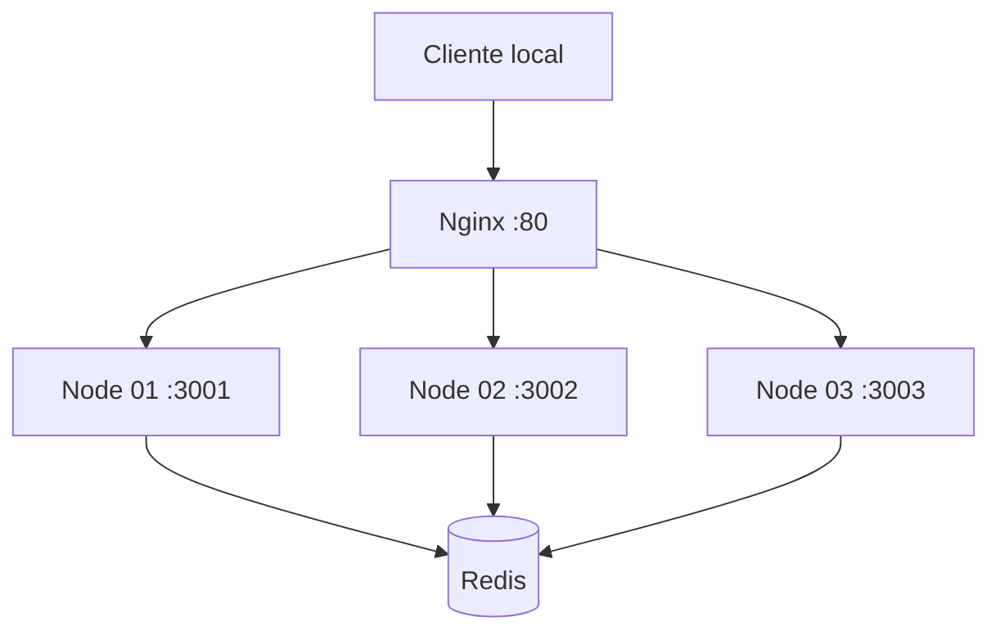

# Nexus Traffic Gateway — Laboratorio de proxy y resiliencia

**Entorno experimental de API Gateway con Nginx, nodos de aplicación y Redis**, orquestado localmente mediante Docker Compose. Permite explorar balanceo de solicitudes, caché y pruebas de carga en un conjunto pequeño de servicios.

> **Estado:** laboratorio de infraestructura. La configuración ilustra técnicas de orquestación, pero **no constituye certificación de alta disponibilidad, seguridad Layer 7 o un SLA empresarial**. No exponer el entorno de forma pública tal como está.

## Arquitectura local



## Componentes

| Ruta | Función |
|---|---|
| [`docker-compose.yml`](docker-compose.yml) | Composición de gateway, Redis y tres nodos |
| [`nginx/`](nginx/) | Configuración del reverse proxy |
| [`cluster/`](cluster/) | Imagen y código de nodos de laboratorio |
| [`dashboard/`](dashboard/) | Material visual o de observación |
| [`stress-test.js`](stress-test.js) | Cliente experimental de carga |
| [`docs/`](docs/) | Revisión de seguridad y plan de evolución |

## Ejecutar en un equipo aislado

**Requisitos:** Docker Engine + Compose. Antes de iniciar, revisa los puertos publicados y configura el entorno exclusivamente en una red de laboratorio autorizada.

```bash
docker compose config
docker compose up --build -d
docker compose ps
docker compose logs -f gateway
```

El Compose actual publica `80:80` y **`6379:6379` de Redis**. Este último puerto expuesto puede ser inseguro fuera de un equipo aislado; debe restringirse al host local o evitarse la publicación antes de compartir el entorno. El laboratorio no incluye controles de seguridad ni pruebas exhaustivas de una instalación pública.

Para detener:

```bash
docker compose down
```

## Qué falta para hablar de resiliencia real

- Health checks comprobables y pruebas de caída de nodos con recuperación medida.
- Configuración explícita de rate limiting, encabezados, timeouts, tamaño máximo y reglas de acceso por ruta.
- No exponer Redis sin autenticación y segmentación de red adecuadas.
- Registro de errores, tiempos p95/p99, métricas de disponibilidad y costo operativo.
- Validar que el test de estrés use únicamente infraestructura propia o autorizada.

## Roadmap

Reproducir fallas controladas, incorporar smoke tests, revisar Nginx y conexiones Redis y medir comportamiento antes de añadir más nodos. Un balanceador con tres contenedores no demuestra por sí solo tolerancia a fallos.

[Plan de ingeniería](docs/ENGINEERING_ROADMAP_2026-11-04.md) · [Escalabilidad](docs/ARCHITECTURE_SCALABILITY_2026-11-04.md).

**Propósito:** aprendizaje de redes y operación de servicios, no plataforma comercial operable.
